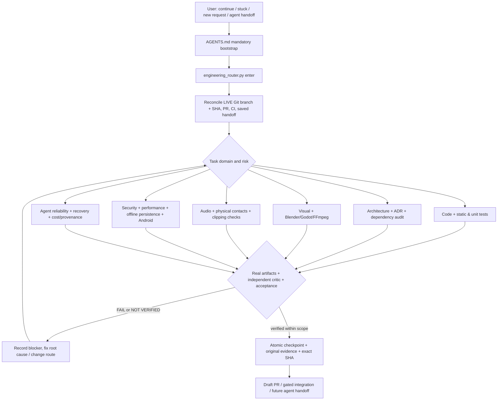

# Unified Engineering Router (canonical, v1)

**Repository:** `xxiamadelxx-blip/dice-metal-barbie`  
**Authority:** `AGENTS.md` → this document → `config/engineering_routes.json` (machine-readable routing) → `docs/handoff/ACTIVE_ROUTING_HANDOFF.json` (durable current state).  
**Runtime implementation:** `scripts/engineering_router.py`. **Actual independent review:** `scripts/gauntlet_autopilot.py` + `scripts/gauntlet_evidence.py` when separate local Ollama models actually execute.

This is the **single mandatory entrypoint** for user instructions like **«продолжай»**, **«завис»**, **«застрял»**, **«передай новому агенту»**, or any fresh substantial Dice task. A chat phrase cannot trigger a shell command by itself. The *agent who receives it* must read this repository protocol and invoke the entrypoint before taking further action. No outside chatbot can be programmatically forced to read GitHub unless it has repo access; report that limitation rather than claiming guaranteed automatic adoption.

## System architecture



The router is **not another game engine**, model provider, CI orchestrator or duplicate Gauntlet. Godot 4.6.3 + Jolt remains the single authority for game logic, physical bodies, face values and rendering. External asset/coding tools only produce source or test evidence. Android product is offline and has no runtime AI/cloud dependency.

## Mandatory recovery protocol

1. On *every* new Dice agent session or task, read `AGENTS.md`, this file, the approved `docs/CONTEXT.md`, `docs/PRD.md`, `docs/ARCHITECTURE.md`, `docs/GAUNTLET_LOOP.md`, and `docs/handoff/ACTIVE_ROUTING_HANDOFF.json`. This step is not skippable by saying “I remember it.”
2. Execute `python3 scripts/engineering_router.py enter --intent "продолжай"` or replace the intent with the literal user instruction. This returns task/domain, exact local HEAD/branch/dirty worktree, stale handoff flag, tools, checks, artifacts and next actions.
3. Independently inspect **current remote GitHub main and open feature PR branch HEAD**, recent failing/green CI, issue scope and approved milestone. A local or saved SHA is **not** proof of live remote state; chat context, screenshots, markdown and cached results do not supersede live Git.
4. For `продолжай`: resume saved route **after** reconciling actual progress and last test evidence. If the saved state is obsolete, repair the handoff before doing more feature work. For `завис`: inspect failed command, last logs and route fingerprint; don't repeat an identical failing action blindly. If context/CI/provider is unavailable, mark `NOT_VERIFIED`, switch to a justified alternate or checkpoint a real blocker.
5. For `новому агенту`: `python3 scripts/engineering_router.py handoff` must provide exact SHA, selected feature scope, unresolved risks, last evidence, next action. A proper handoff is **committed and pushed** on the relevant branch or PR; writing local JSON is not remote persistence.
6. Before leaving or losing context, run `checkpoint` with concrete task, route, next action, status and genuine evidence links. A checkpoint only writes tracked JSON **locally**. The current agent must commit/push it to make it discoverable to a later agent.
7. If the agent has **no terminal**, the same protocol is still mandatory: read `AGENTS.md`, inspect `config/engineering_routes.json` and handoff JSON via GitHub, compute routing from that registry, report which CLI checks were unavailable, and checkpoint/push through the GitHub connector. **Never claim the CLI ran when it did not.**

### CLI

```bash
python3 scripts/engineering_router.py validate
python3 scripts/engineering_router.py audit
python3 scripts/engineering_router.py enter --intent "продолжай"
python3 scripts/engineering_router.py enter --intent "завис"
python3 scripts/engineering_router.py enter --intent "передача новому агенту"
python3 scripts/engineering_router.py enter --intent "добавь звуки столкновения костей"
python3 scripts/engineering_router.py enter --intent "анализ архитектуры" --route architecture
python3 scripts/engineering_router.py handoff
python3 scripts/engineering_router.py incident --route code \
  --fingerprint "same command + same input + same hypothesis" --outcome failed \
  --classification "test-timeout" --evidence "artifact://REAL-CI-LOG"
python3 scripts/engineering_router.py checkpoint \
  --task "M4 physical percentile reroll" --route reliability-persistence \
  --status in_progress --owner "current Dice agent" \
  --next-action "Run live Jolt tests at candidate SHA and inspect trace" \
  --evidence "https://github.com/xxiamadelxx-blip/dice-metal-barbie/actions/runs/EXACT"
```

The last URL above is a **placeholder command example**, not an actual test record.

## Canonical specialist routing (13 lanes)

| Lane | Authority / likely tools | Evidence that grants PASS |
| --- | --- | --- |
| Agent operations | Git, Python stdlib, connected GitHub; skills where present | SHA, root-cause/blocked ledger, next step, committed checkpoint |
| Code | Godot headless, Python unit tests; candidate gdtoolkit/LSP/Tree-sitter | tests exercising touched behavior, independent critic and real source diff |
| Architecture | `docs/ARCHITECTURE.md` + ADR; Mermaid or candidate Structurizr | measured dependencies, no forbidden cross-layer calls, clear accepted ADR |
| 3D/visual | Blender, Godot/Jolt, FFmpeg, MeshLab/Pillow if proven | actual authored GLB, geometry + same-scene screenshot, full-frame video when needed |
| Interface/accessibility | Godot Controls, real screen capture, Figma/Inkscape only when authorized | interaction screenshots, legibility/hit targets/keyboard/accessibility gates |
| Audio/haptics | Godot contact events, FFmpeg/ffprobe, candidate Audacity/SoX/jsfxr | actual contact-synced playback, peak/clipping and device audition |
| Security | Gitleaks/Semgrep/Trivy/OSV only when installed and relevant | real findings/secret check, permission and source review |
| Performance | Godot profiler, Android Perfetto, ADB, frame timing | measured engine/device FPS, 60fps frame budget ~16.67ms, thermal/memory evidence |
| Reliability/persistence | Jolt stress, offline restart, save-corruption tests | actual long-run/failure/recovery reports |
| Android/release | Godot export, Android AVD, apksigner, ADB | APK/cert hashes + on-phone install/upgrade, no loss of existing app data |
| Supply chain/licensing | source manifests/SBOM, OSV/Trivy if useful | license/asset provenance and pinned dependencies |
| Observability | local structured logs, CI artifacts, optional external monitoring | actual log source and event identity, no app runtime telemetry requirement |
| QA critic | exact-SHA tests, separate local Ollama models by default | truly independent reviewer evidence, closed findings, no failed required gate |

### Existing visual subsystem: preserve instead of duplicating

`docs/CREATIVE_TOOLCHAIN.md`, `docs/TOOLCHAIN_ARCHITECTURE.md` and the advanced Blender/Jolt/24fps workflows currently appear in the **open implementation PR #23** but not in the checked `main` baseline as of initial installation. Before integration, read the *live PR* to see whether they were merged, and import their real decisions without substituting fake placeholders. Never use the governance architecture to overwrite Blender assets, physics or the approved minimalist UI.

### Audio production route (before M5)

`physical Jolt contact event -> impulse/relative velocity -> controlled sound bank or procedural hit -> Godot Audio Bus -> WAV/OGG peak/clip check -> captured real playback -> independent listening/Android check`.

Do **not** generate a sound effect on a timer unrelated to physics. Audio candidates are build-time tools, never APK runtime services. For low-cost/offline music or sound, keep source/licensing provenance. This file specifies a routing process, **not** a claim that sound files or Godot audio are already implemented.

### Architecture quality (C4 + code truth)

Use a **C4 context/container/component graph** and an ADR for consequential changes. Mermaid is the baseline textual renderer. Structurizr is optional if installed and validated. The source graph is ultimately derived from actual Godot scripts/imports; a hand-drawn diagram is not proof that the code follows its declared boundaries. Protect approved conventions: UI must not invent dice outcomes, art is not physics, offline state is canonical and stable.

## Execution standards

- **Routing:** `config/engineering_routes.json` lists possible tools, alternatives and mandatory artifacts. The selection algorithm chooses the best matched domain, not all tools. It never installs software; `audit` reports `binary-found` vs `not-detected`, distinct from functioning export, authorized connector, successful APK and visual acceptance.
- **Adaptive checks:** use the cheapest relevant gate first and escalate proportionally. Python-only docs/route work should not trigger a full Blender/Android build. Physics changes require Godot/Jolt; rendered roll/UI changes require full temporal evidence; release requires Android. A clean source compile is not a milestone PASS.
- **Gauntlet:** an isolated approved task → frozen SHA → real narrow checks → separate raw-artifact critic → fix and new SHA → broad regression. `scripts/gauntlet_autopilot.py` runs two separate **local** Ollama models by default with no service API key; absent/failed model review is `NOT_VERIFIED`. See `docs/GAUNTLET_AUTOPILOT.md`.
- **Anti-stall:** no more than two identical failed attempts without new evidence/hypothesis/tool. Unavailable tools change route; do not pretend they ran or ask the user to buy services for an offline personal app.
- **Security:** never commit provider/API tokens, debug/release keystores, private user data or unlicensed media; no paid provider or external account without approval. Running untrusted code/test commands needs an isolated runner and bounded time/resource budget.
- **Performance:** real hardware vs emulator vs Mesa software-rendered capture are separate evidence classes; 24fps encoding does not establish 24 distinct renders or 60fps on OnePlus Nord 3.
- **Handoff:** never leave `status=verified` without authentic evidence; saved file is a resume pointer, not an authority over live Git/CI. Different PR branches may hold differing checkpoints; reconcile carefully.
- **Versioning:** changes to the router registry, documentation, Python contracts and this architecture need a dedicated test/PR and review. Avoid new autonomous write controllers or another competing `AGENTS.md`.

## Tests and acceptance of this routing layer

```bash
python3 -m unittest discover -s tests -p 'test_engineering_router.py' -v
python3 scripts/engineering_router.py validate
python3 scripts/engineering_router.py audit
python3 scripts/engineering_router.py enter --intent "завис"
```

These are **router/contract tests**, not proof that Godot/Android/SFX specialists have shipped features. Validate the live exact SHA in CI and do not declare full agent self-healing from a deterministic mock. For a new feature, store test/video/critic evidence in its own PR.

### Responsibility map

- `AGENTS.md`: short binding entrypoint policy.
- `docs/ENGINEERING_ROUTER.md`: **canonical operating rule and architecture** (this file).
- `config/engineering_routes.json`: tool/domain registry, dispatch, acceptance evidence.
- `scripts/engineering_router.py`: executable dispatch/doctor/atomic checkpoint/restore.
- `docs/handoff/ACTIVE_ROUTING_HANDOFF.json`: persistent resume pointer, updated only with true task evidence.
- `scripts/gauntlet_autopilot.py`, `scripts/gauntlet_evidence.py`: independent model execution and acceptance contract.
- `docs/GAUNTLET_LOOP.md`: product-agnostic acceptance loop; native Blender/Godot/Jolt/Android workflows own their domain results.
- `.github/workflows/engineering-router-contract.yml`: inexpensive stdlib CI test, no provider access/no source modification.

## Executable offline specialty audits (no paid services)

The initial install includes `scripts/engineering_checks.py`, four concrete engineering analyzers beyond the dispatch catalogue:

```bash
python3 scripts/engineering_checks.py architecture
python3 scripts/engineering_checks.py security
python3 scripts/engineering_checks.py audio --file path/to/authorized.wav
python3 scripts/engineering_checks.py performance --input path/to/raw-measured-frame-timings.json
python3 -m unittest discover -s tests -p 'test_engineering_checks.py' -v
```

- **Architecture** scans only literal GDScript `preload/load` edges; missing source, dependency cycles and forbidden `src/core → src/ui/visual` or `src/dice → src/ui` fail. It does not understand reflection/dynamic loads or every Godot dependency.
- **Security** checks for likely private key blocks and several token patterns under source/scripts/workflow paths; output contains only file + line + rule, never matched key bytes. Gitleaks/Trivy/Semgrep are optional deeper scanners when installed.
- **Audio** examines real PCM16 WAV header, signal peak, excessive near-clipping, silence, DC offset and length; cannot prove aesthetic quality, contact synchronization, OGG export or playback on OnePlus.
- **Performance** consumes *actual* input telemetry JSON such as `{"device_kind":"phone","device_model":"OnePlus Nord 3","target_fps":60,"frame_ms":[12.3,15.2,...]}` with 30+ real frame durations. A Mesa or emulator result **never** becomes phone PASS; source telemetry itself must still be authenticated by the agent. Never invent measurements to pass this test.

These are specialized **static/signal checks**, not a substitute for a separately authorized Gauntlet critic, Godot full-frame capture or Android user-device validation. No audio effects or actual phone profiling is claimed completed by creating these scripts. The canonical router picks domain(s); the agent executes the relevant checks with real input and attaches outputs to the feature PR.

## Enforced anti-stall ledger

`engineering_router.py incident` records an exact `route + input/approach fingerprint`, real evidence link and failure classification under `docs/handoff/ACTIVE_ROUTING_HANDOFF.json:incidents`. **Two unchanged failures** set active status to `blocked`, add a `DO NOT RETRY` blocker and refuse a third identical attempt. A true new hypothesis is a **new fingerprint** with real supporting source evidence; it must not be an arbitrary renamed key for the same failure. A resolved issue can be recorded with `--outcome resolved`, and a subsequent checkpoint retains the incident ledger. The user does not need to repeatedly type «завис» just to restart the same failing command.

This is a trackable local gate. For cross-agent persistence, the agent **must commit/push** the handoff file. The GitHub connector can provide an equivalent update when a terminal is unavailable; never claim an automatic background monitor if no scheduled or live process exists.

**SHA terminology:** `last_observed_sha` means the git commit visible to the agent, even before testing. `last_verified_sha` is set only for a `verified` checkpoint with recorded real evidence. Neither a Git SHA nor an evidence URL is proof that the linked test actually passed; the receiving agent must inspect the original CI artifact.


### Local independent critic (the default, without OpenRouter)

On Linux GitHub Actions, `.github/workflows/gauntlet-autopilot.yml` prepares CPU-only Ollama through `scripts/gauntlet_setup_local.sh`. Different weights `qwen2.5-coder:1.5b` (builder) and `qwen2.5-coder:7b` (critic) get separate raw prompts; the latter sees committed source diff and test output. No GitHub Secret or API-credit key is used. It is a narrow, low-resource supplementary code review, not a substitute for Godot physics, 24fps screenshots or real Android handset QA. Verify the actual first live run before claiming working independent critic. See `docs/GAUNTLET_AUTOPILOT.md`.

### M5 premium materials production gate (audit 2026-10-12)

For an approved M5 art slice, route through **existing `creative-3d` + `qa-critic`**, `docs/CREATIVE_TOOLCHAIN.md` and `docs/research/M5_FREE_PREMIUM_MATERIALS_ACTIONABLE_AUDIT_2026-10-12.md`. Do not create another controller. The frozen unit of work is **D20 obsidian + velvet**, not all editors launched indiscriminately. Separate Blender Cycles authoring render, Godot Compatibility/OpenGL diagnostic render, configured Godot **Mobile** frame and true Android hardware; each is a different evidence class. A valid offline Blender AO image alone does **not** prove runtime AO unless glTF/Godot occlusion has been verified. A pixel/CI PASS or Qwen code critique never equals independent premium visual approval. Protect the active **M4** boundary and PR #23 draft; preserve 90-degree overhead view and Jolt face/collision/mass truth. At observed source `51612370a980`, Blender real BVHTree AO gate PASS, D4 native facet FAIL (6.63 below 8), AVD source-reroll drawer FAIL; artifacts and corrective order in the linked research audit. If subsequent exact-SHA CI differs, update the audit and handoff based on new source logs rather than carrying forward stale verdicts.
