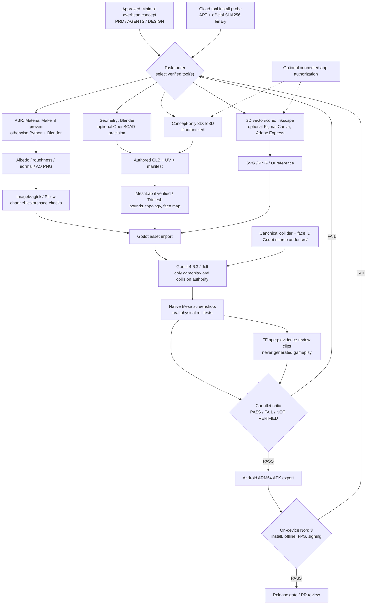

# Creative-tool architecture for D&D Dice

## Ownership
This is a **build-time production graph**, not a proposed switch from Godot. **Runtime must be Android-offline.** Each node lists the authoritative artifact, validation gate and fallback. These components form a pipeline; agents should not launch every tool on every change.

## Architecture invariants
- **Engine authority:** source `src/core/` + `src/dice/` and Jolt world determine roll, outcome and collision. External meshes/materials are **visual only**. No converter can substitute results.
- **No runtime editor dependencies:** Blender, MeshLab, OpenSCAD, Krita, GIMP, Material Maker, Inkscape, FFmpeg, Trimesh and SaaS tools never ship inside APK.
- **Deterministic offline-first artifacts:** source scripts, tool versions, checksums, license, image profiles, mesh bounds and export manifest are committed or attached as CI artifacts.
- **Optional service isolation:** Figma, Canva, Adobe Express and to3D require separate connected permissions and can be replaced by local/offline flows. No paid subscription or auth loop is a release dependency.
- **QA truth:** installation != launch != headless export != correct asset != shipped working application. Track each gate individually.
- **Change control:** task work goes into feature branch/draft PR, CI tests against the actual PR head and only tests/approves production changes after verified evidence.
- **Escalation:** user approval only on new spending/account/rights/architecture changes or real-device step unavailable to the agent.

## Artifact contracts
| Stage | Required source | Output and check |
|---|---|---|
| Modeling | Blender Python/SCAD, fixed numeric face mapping | GLB + mesh manifest + bounds/UV check |
| Materials | `.ptex` or procedural Python/Blender source | PNG albedo/roughness/normal, non-color map settings, reproducible export |
| 2D | SVG, `.kra` or `.xcf` as available | optimized PNG/vector, color and provenance checks |
| Integration | `src/` and generated assets | Godot render screenshots + live physics invariants |
| Presentation | captured Godot PNGs/videos | FFmpeg provenance + artifact hash |
| Ship | CI tests/export and signed APK | true Android ARM64 binary; device FPS/update independent gate |

[Route rules](CREATIVE_TOOLCHAIN.md) · [Installation test results](TOOL_INSTALL_AUDIT.md) · [Autonomous loop](GAUNTLET_LOOP.md)
