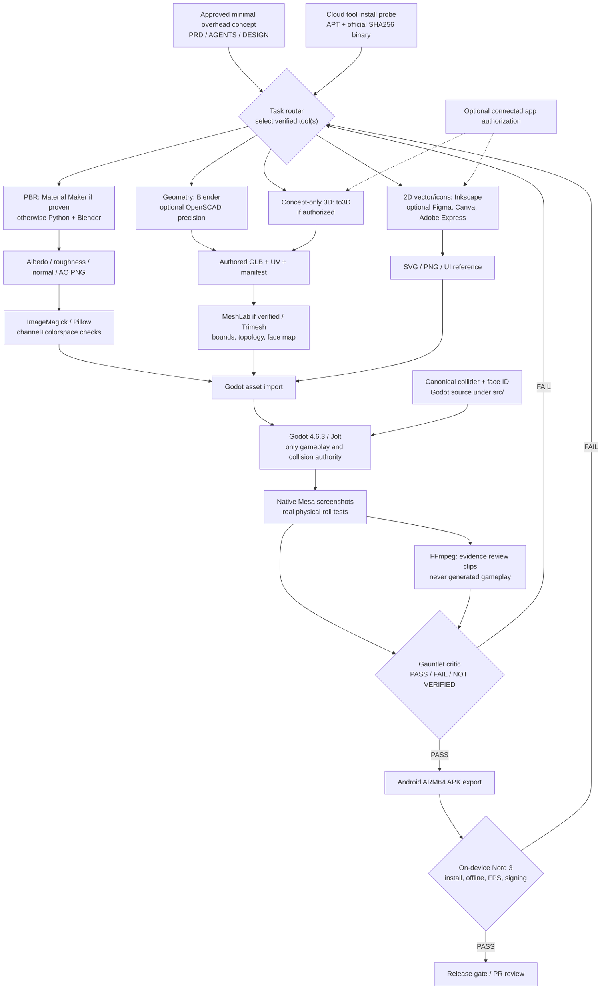

# Creative-tool architecture for D&D Dice

## Ownership
This is a **build-time production graph**, not a proposed switch from Godot. **Runtime must be Android-offline.** Each node lists the authoritative artifact, validation gate and fallback. These components form a pipeline; agents should not launch every tool on every change.

## Architecture invariants
- **Engine authority:** source `src/core/` + `src/dice/` and Jolt world determine roll, outcome and collision. External meshes/materials are **visual only**. No converter can substitute results.
- **No runtime editor dependencies:** Blender, MeshLab, OpenSCAD, Krita, GIMP, Material Maker, Inkscape, FFmpeg, Trimesh and SaaS tools never ship inside APK.
- **Deterministic offline-first artifacts:** source scripts, tool versions, checksums, license, image profiles, mesh bounds and export manifest are committed or attached as CI artifacts.
- **Optional service isolation:** Figma, Canva, Adobe Express and to3D require separate connected permissions and can be replaced by local/offline flows. No paid subscription or auth loop is a release dependency.
- **QA truth:** installation != launch != headless export != correct asset != shipped working application. Track each gate individually.
- **Change control:** task work goes into feature branch/draft PR, CI tests against the actual PR head and only tests/approves production changes after verified evidence.
- **Escalation:** user approval only on new spending/account/rights/architecture changes or real-device step unavailable to the agent.

## Artifact contracts
| Stage | Required source | Output and check |
|---|---|---|
| Modeling | Blender Python/SCAD, fixed numeric face mapping | GLB + mesh manifest + bounds/UV check |
| Materials | `.ptex` or procedural Python/Blender source | PNG albedo/roughness/normal, non-color map settings, reproducible export |
| 2D | SVG, `.kra` or `.xcf` as available | optimized PNG/vector, color and provenance checks |
| Integration | `src/` and generated assets | Godot render screenshots + live physics invariants |
| Presentation | captured Godot PNGs/videos | FFmpeg provenance + artifact hash |
| Ship | CI tests/export and signed APK | true Android ARM64 binary; device FPS/update independent gate |

[Route rules](CREATIVE_TOOLCHAIN.md) · [Installation test results](TOOL_INSTALL_AUDIT.md) · [Autonomous loop](GAUNTLET_LOOP.md)

## M5 execution through one canonical router (2026-10-11)

This is the user-approved pipeline pictured in the architecture image, implemented by `AGENTS.md` / `config/engineering_routes.json` rather than a competing agent. The cloud *production entrypoint* is the existing exact-SHA `.github/workflows/gauntlet-release-gate.yml`, which calls `blender-assets.yml` before its native/Android physical consumers.

| Input / reason | Verified route | Proof before integration | Do not confuse with |
| --- | --- | --- | --- |
| Premium die facets and real engraving | **Blender Python** source `tools/blender/generate_die_assets.py`, official fonts | Per-die true boolean engraved `.glb`, preview PNG, QA PLY, hash in `m5-route-manifest.json` | Merely importing or tinting a collision hull |
| Mesh QA | **MeshLab** under Xvfb with PLY→OBJ + existing Python GLB validator (Trimesh optional) | Non-empty converted OBJ for EACH five sculpted die and validation report | Mere `meshlab --version` |
| Obsidian & velvet PBR | **Blender/Python + ImageMagick** by default; Material Maker only after real checksum-verified `.ptex` export | Albedo, roughness and normal files checked for real size, color-space and actual Godot import | An installed but unproven texture editor |
| Real interface glyphs | **Inkscape** authored `src/assets/ui/m5_roll_action.svg` exported to PNG | 256×256 generated image and hash; integrate in Godot only after mobile legibility review | SVG prototype claimed to be the final HUD |
| Additional hand painting | **Krita / GIMP** only for needed actual art with tested real output | Owned editable source + PNG export with preserved alpha/ICC; otherwise CLI fallback | CLI version or virtual-display smoke |
| Parametric constraints / reference shape | **OpenSCAD / to3D**, only for tasks requiring them; to3D only when connected/authorized | Revalidated mesh fed through Blender and Godot, never direct Jolt result | Automatically using a reference as verified physical dice |
| Gameplay truth and full review | **Godot 4.6.3/Jolt → FFmpeg → screenshot/frame critic → Android AVD / ARM64** | Exact-SHA 8-mode physical/source-frame video and auditable JSONL; no false black/frozen success | Nominal 24fps file = actual render FPS; AVD = Nord 3 |

The same-run artifact SHA256 check means no stale models are imported. **Build success does not approve styling**, so the next M5 visual critic must open original Godot and Android images against Concept 3 and record a concrete discrepancy list. Existing local Qwen 7B is a *source critic*, not a model that has visually seen every screenshot. OnePlus Nord 3 GPU FPS and real release signing remain M6 gates.
