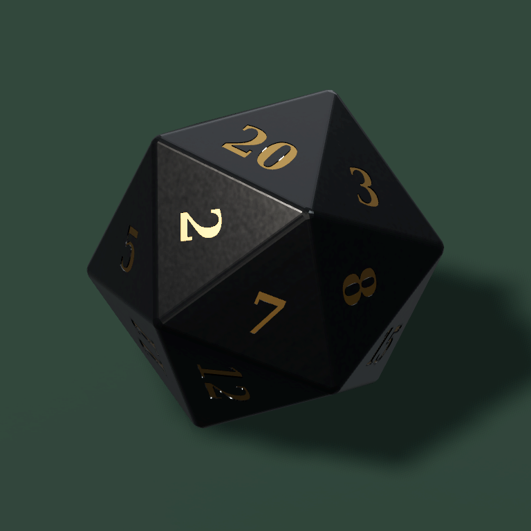
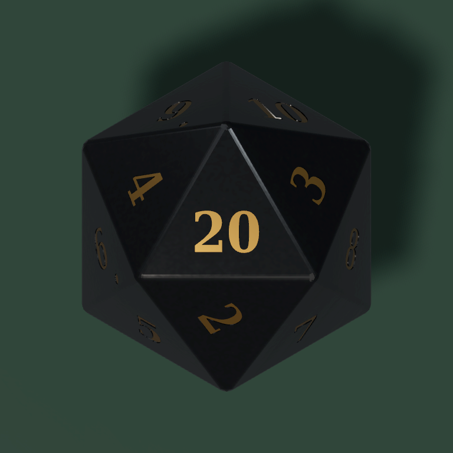
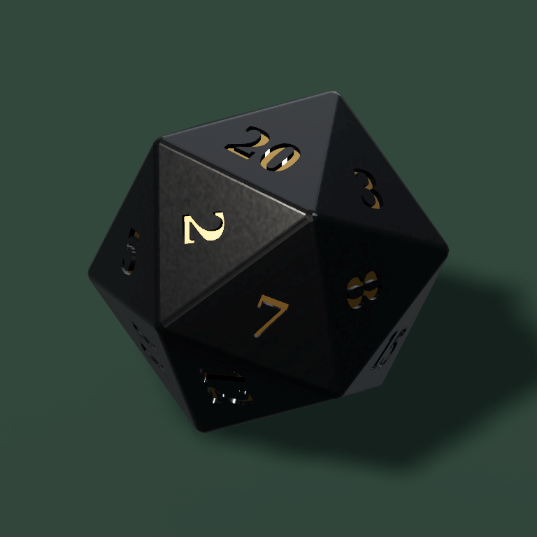

# D20: actual Godot Mobile reference experiment, 2026-10-12

**Outcome:** real Godot 4.6.3 Mobile/Vulkan renders demonstrate a usable black-stone/gold direction. The evidence does not establish a need to replace Godot. It also does not establish final premium art acceptance, phone performance, or a completed application integration. M5 remains ACTIVE/OPEN.

User requested an isolated test after comparing a Blender/Cycles screenshot with the existing grey Godot app. The exact supplied GLB was first imported unchanged and rendered in Compatibility and Mobile. Earlier dark/overbright results were rejected by direct self-review. The final original and a separate Blender candidate use identical studio parameters and camera poses.

## Final raw engine output

Candidate, oblique inspection view:

Candidate, approved 90-degree overhead camera:

Original GLB with the **same final light and camera**, without gold translation:

[Original overhead](../evidence/d20-reference-2026-10-12/godot-mobile-original-overhead.png). PNGs are copied directly from the Godot viewport, without repainting, denoising, color correction or generated-image substitution. SHA256 and Git blob hashes are in [artifact-manifest.json](../evidence/d20-reference-2026-10-12/artifact-manifest.json).

## Concrete findings and changes

1. The native Godot import retained core PBR textures and connected AO but left authored `KHR_materials_clearcoat` disabled. The isolated review restores exact JSON values: stone coat `0.12`, coat roughness `0.13`; gold coat `0.06`, default extension roughness `0`. This is an adapter for the author's coating, not the application's generic material wrapper. Stone stays dielectric (`metallic=0`), gold stays metallic (`1`, roughness `0.35`); neither emits light.
2. Black bands on glyphs persisted with directional shadows disabled. Independent triangle-ray intersections showed real body-wall occlusion in the supplied GLB under the inspection view. The candidate moves the 22 existing gold meshes outward by `0.023` model units, leaving about `0.00685` of recess. Stone, glyph shapes and twenty number directions are unchanged.
3. The first HDR/light setup was too dark; the next setup clipped the overhead gold highlight. The final studio reduces panel/key energy, uses a key elevation of 58 degrees, retains a real reflection panorama, and filters directional shadows at high quality. This is a neutral matte review floor, not completed production velvet.
4. Imported automatic LOD changed some edge appearance. Full source geometry is used for review. Disabling LOD did **not** resolve the glyph bands; the visibility audit identified their geometric cause.

The app's current material wrapper changes dielectric/coat/normal values and enables gold emission on its older named assets; it does not copy the source AO. Its name checks (`Sculpted_Obsidian...`, `Recessed_Bronze...`) do **not** match this uploaded GLB. Therefore it would be incorrect to claim the new GLB was automatically overwritten by that wrapper. This isolated project never invokes it.

## Verified evidence

| Check | Actual result |
| --- | --- |
| Engine | Official Godot `4.6.3.stable.7d41c59c4` |
| Final renderer | `mobile`, Vulkan `1.4.318`, Mesa llvmpipe LLVM 20.1.2 |
| Original GLB | 2,672,464 bytes; SHA256 `c5d971370fae51328461cbd220293d9445a14d7fd6f182b623f52551dbb8fa27`; unchanged |
| Candidate | Actual Blender 4.0.2 export; SHA256 `80bd2337d1f0fdee1e02a039b81693a46e0633d54eb2b5621c8afe90595739a2` |
| Meshes | 23 imported meshes, including 20 values and 6/9 dots |
| Stone geometry | Original world positions and 9,544 triangles preserved |
| Semantic texture pixels | Albedo, normal, AO red and roughness green preserved |
| Number orientation | All 20 directions preserved; opposite pairs sum to 21 |
| Original→candidate occluded front-centroid samples | `20: 112/176→24/176`; `2: 26/80→9/80`; `8: 96/194→11/194` |
| Captures | 768×768, oblique inspection plus strictly overhead, actual viewport PNGs |
| Final engine log | Exit 0, no script error/crash, real completion receipt, no renderer fallback |

Centroid ray counts are samples of geometry, **not percentages of glyph pixel area**. Review views are frozen poses, not physical rolls or asserted game outcomes. The top `20` comes from the authored model's static orientation.

[Geometry audit](../evidence/d20-reference-2026-10-12/geometry-audit.json), [candidate engine receipt](../evidence/d20-reference-2026-10-12/candidate-render-receipt.json), [original receipt](../evidence/d20-reference-2026-10-12/original-render-receipt.json), [candidate log](../evidence/d20-reference-2026-10-12/candidate-engine.log), [original log](../evidence/d20-reference-2026-10-12/original-engine.log), [reproducible scene and tools](../../tools/visual/d20_reference_review/README.md).

## Limits and next integration gate

Technical static/geometry checks passed. Adversarial **self-review** inspected actual frames; an independent artistic critic is NOT VERIFIED. Comparison with the supplied Cycles screenshot is qualitative: its camera, lights and exact rendering history are unavailable. This experiment neither proves nor disproves the prior claimed 20-minute duration or screenshot provenance.

Nord 3 installation/FPS/thermal behavior, real Jolt rolls, outcome-to-visible-face agreement for an attached new GLB, complete 24fps sequences, Android AVD and production velvet/UI remain NOT VERIFIED by this experiment. No application source, collision, mass, Jolt face IDs, accepted overhead camera or release workflow changed. Do not merge or close M5 on these stills alone.

Next: align the candidate's authored face directions with the canonical collision/face mapping, preserve source PBR through runtime import, then run the existing same-run Jolt/ARM64/24fps/AVD Gauntlet before integration. Revise style-only tests that enforce arbitrary metallic/coat values or exactly two meshes; retain topology, physical outcomes, image evidence and animation gates. Assess actual app frames before claiming production quality.

Base context: PR #23 at `51612370a980e1355d897e84cdcd4503930f79c7`; main `5f9333cf4a4e8f1fe979b0c7498a30e33222f601`. Parent PR body remains stale about M4. Governing AGENTS/MILESTONES identify M5 as active, with M4 cloud-functional pass at run `38171350517`. This experiment runs on a separate feature branch and does not merge/replace the parent development.
