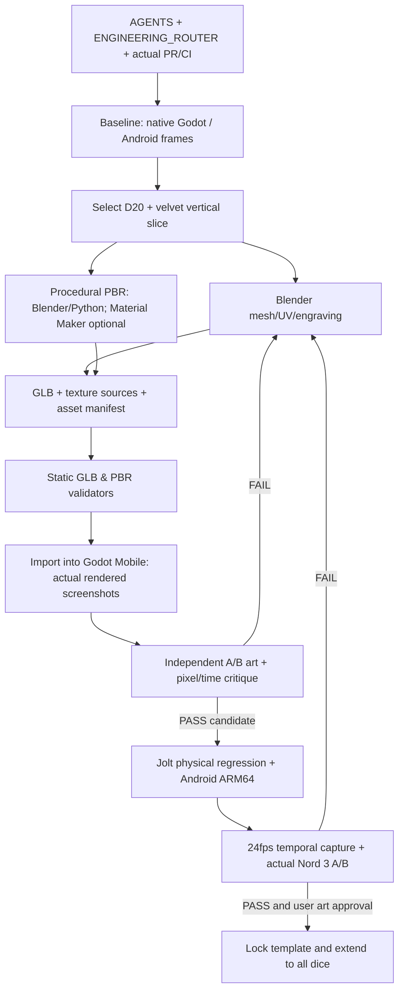

# D&D 3D Dice Roller: исследование и план производства премиальных скинов кубиков и поверхности стола

**Версия:** 1.0 · **Дата:** 12 октября 2026 · **Формат:** исполнимый исследовательско-инженерный план  
**Проект:** [`xxiamadelxx-blip/dice-metal-barbie`](https://github.com/xxiamadelxx-blip/dice-metal-barbie)  
**Бюджет на инструменты / ассеты / API:** **0 ₽**  
**Объект работ:** художественное качество материалов, геометрии и освещения. **Физика и результаты броска не изменяются.**

> **Статус документа: PLAN / RESEARCH, не IMPLEMENTED.** Файл не означает, что материалы уже созданы, визуально утверждены, протестированы на телефоне или влиты в `main`. Он учитывает просмотренные файлы существующего репозитория и открытой ветки PR #23 по состоянию на подготовку; перед реализацией необходимо повторно проверить актуальные HEAD и CI.

---

## 0. Краткое решение

Достичь премиального качества можно **без платных ИИ-генераторов**. Основной путь: **Blender (геометрия, реальная гравировка, UV, baking) → процедурные PBR-карты в Blender/Python, опционально Material Maker → Godot 4.6.3 Mobile (настоящий игровой кадр) → Gauntlet A/B с реальными скриншотами и Jolt-регрессией → Android**.

**Главная гипотеза:** проблема не решается одним красивым изображением текстуры. Нужна согласованная система из **формы граней, качества гравировки, корректных albedo/roughness/normal/AO, света, отражений, экспозиции, реального масштаба волокон бархата и контролируемого импорта**. Для тёмного обсидиана грамотное отражение студийного источника зачастую даёт больше визуального результата, чем увеличение разрешения карты с 1K до 4K.

**Первый вертикальный срез (без массовой переработки):** один D20 + один участок бархатного стола. Полностью сравнить A/B на одном и том же кадре, угле и освещении, затем тиражировать метод на D6/D8/D10/D12/D4. **Никакого перехода с Godot на Three.js, смены Jolt, подмены номера при выпадении или накладных «цифр вместо физики».**

**Рекомендация по авторингу:** не делать нейросетевую картинку единственным источником Base Color и не строить fake-PBR простым превращением RGB в normal/roughness. Основу даёт процедурный управляемый материал и реальная микрогеометрия; AI-изображение, если доступно пользователю в ChatGPT, выступает **необязательным** источником художественных мотивов, микрорисунка или цветовой маски с обязательным удалением запечённых бликов.

## 1. Подтверждённый контекст проекта и ограничения

Проверены исходники/документы в GitHub:

- [`AGENTS.md`](https://github.com/xxiamadelxx-blip/dice-metal-barbie/blob/main/AGENTS.md) и [`docs/ENGINEERING_ROUTER.md`](https://github.com/xxiamadelxx-blip/dice-metal-barbie/blob/main/docs/ENGINEERING_ROUTER.md): вход через единый инженерный роутер; Gauntlet Loop; сохранение физики и approved UX; evidence-first.
- PR [#23](https://github.com/xxiamadelxx-blip/dice-metal-barbie/pull/23), issue [#24](https://github.com/xxiamadelxx-blip/dice-metal-barbie/issues/24): премиальный визуал **ещё не принят**; модель D20 ранее выглядела «проволочной клеткой», цифры и физический объём недостаточно читаемы.
- `project.godot` в feature-ветке: **Godot 4.6.3, Jolt Physics, Mobile renderer**, вертикальный viewport **720×1280**, включён импорт ETC2/ASTC; физический шаг **120 Гц**.
- Существующие материалы: [`src/visual/obsidian.gdshader`](https://github.com/xxiamadelxx-blip/dice-metal-barbie/blob/feat/m5-approved-minimal-premium-visual-pass-1/src/visual/obsidian.gdshader), [`src/visual/velvet_contact.gdshader`](https://github.com/xxiamadelxx-blip/dice-metal-barbie/blob/feat/m5-approved-minimal-premium-visual-pass-1/src/visual/velvet_contact.gdshader). Есть процедурная имитация отражения и почти матовый бархат; **не путать это с калиброванным физическим освещением**.
- Есть уже сформированный офлайн-пайплайн [`tools/blender/generate_die_assets.py`](https://github.com/xxiamadelxx-blip/dice-metal-barbie/blob/feat/m5-approved-minimal-premium-visual-pass-1/tools/blender/generate_die_assets.py) и [`docs/BLENDER_ASSET_PIPELINE.md`](https://github.com/xxiamadelxx-blip/dice-metal-barbie/blob/feat/m5-approved-minimal-premium-visual-pass-1/docs/BLENDER_ASSET_PIPELINE.md): реальная boolean-гравировка, GLB, манифест и CI.
- [`docs/M5_D20_PBR_LOOKDEV.md`](https://github.com/xxiamadelxx-blip/dice-metal-barbie/blob/feat/m5-approved-minimal-premium-visual-pass-1/docs/M5_D20_PBR_LOOKDEV.md): D20 имеет UV-атлас 5×4, пробные 1024² карты; первоначальное Cycles AO-запекание дало **полностью чёрный** результат. Добавленный валидатор не доказывает, что последующая AO-карта уже признана годной.
- [`docs/M5_AI_TEXTURE_AUDIT_2026.md`](https://github.com/xxiamadelxx-blip/dice-metal-barbie/blob/feat/m5-approved-minimal-premium-visual-pass-1/docs/M5_AI_TEXTURE_AUDIT_2026.md): AI-картинка применялась только как экспериментальный `baseColorTexture`, **не как полный PBR-пакет**; A/B-кандидат не принят и не перенесён в production.
- [`docs/M5_REAL_CONTACT_FELT.md`](https://github.com/xxiamadelxx-blip/dice-metal-barbie/blob/feat/m5-approved-minimal-premium-visual-pass-1/docs/M5_REAL_CONTACT_FELT.md): визуальное локальное продавливание бархата уже спроектировано через реальные контакты, при этом Jolt-коллайдер неподвижен.

**Стадия разработки:** по проверенному тексту PR #23 действующая основная приёмка ещё **M4**, а полноценный premium-art **M5** отложен. План ниже следует хранить как самостоятельную задачу M5, не выдавая её за завершённую M4. Действительные статус, SHA, ветка и Actions должны быть перепроверены непосредственно перед началом работы. По содержимому репозитория нельзя подтвердить текущую частоту кадров OnePlus Nord 3 или утверждённый финальный арт.

### Неизменяемые требования

1. **Строго ортографическая камера сверху, 90°**, без произвольного наклона или изометрии.
2. Чёрные обсидиановые объёмные кости: обработанные грани, правильные фаски, читаемые **реально утопленные** золотые цифры; минимум визуального шума.
3. Контрастный, тактильный, тёмный **бархатный** стол, отдельная отделка бортиков, ощущение студийной предметной съёмки.
4. Геометрия визуала может меняться, но **коллизия/масса/грани/числовая таблица и результат Jolt** неизменны. D4 считывается по вершине; D100 имеет одобренные режимы.
5. Продукт работает **офлайн на Android**; сеть, аккаунт, облачный AI, пользовательские ключи не требуются в приложении.
6. Платные сервисы, API, кредиты, подписки, платные ассеты и изображения с непроверенным разрешением на использование **запрещены как зависимости**.

---

## 2. Причины, которые способны испортить картинку даже при хорошей модели

| Симптом на экране | Вероятная причина | Как доказать | Правильное исправление |
|---|---|---|---|
| Чёрный «пластмассовый» многогранник | Нет читаемых широких отражений / слишком тёмный albedo / неверная металлическая модель | A/B одной модели: матовый серый, затем PBR + HDRI/softbox | Настроить свет/окружение, затем roughness и базовый цвет; не заливать всё emission |
| Золотая сетка вместо скульптуры | Линии над поверхностью, неверный зазор фаски, слишком яркая обводка | Macro-снимок D20, проверка глубины/силуэта | Геометрическая фаска и тонкая утопленная инкрустация; отказаться от «парящих» трубочек |
| Белые/серые засветы вместо камня | Base Color PNG слишком светлый; двойное умножение tint; некорректная цветовая модель | Inspect sRGB и albedo_factor по glTF/в Godot | Контроль RGB и linear, одинаковый нейтральный множитель для теста |
| Объёмный текст выглядит наклеенным | Символ лишь сверху поверхности, отсутствуют стенки выемки и AO | Разрез меша + macro под боковым светом | Boolean-вырез / inset cavity, контактная окклюзия и полированное дно |
| Рельеф будто вывернут | DirectX normal вместо OpenGL (инверсия G/Y) | Направленный тестовый свет слева/справа | Инвертировать Y normal в импорте или экспорте |
| Швы/разрывы на гранях | Spherical UV, некорректный tangent basis, overlapping islands и малый padding | UV-debug checker + tangent/normal heatmap | Планарные UV per-face с достаточным отступом и bake margin |
| Чёрное/белое AO после bake | Неверная нода image target, выбор active bake, clear, cage/rays или неверная сцена | Histogram, min/max/percentiles + проверка изображения глазами | Исправить bake setup и контроль реальной полутоновой структуры, не считать наличие файла PASS |
| Стол выглядит как камень/облака | Изотропный шум и сильная normal, отсутствие направленного ворса | Macro 1:1 и при масштабе игрового кадра | Волокна, anisotropic-структура, микрорельеф низкой амплитуды |
| Повторение текстуры видно плиткой | Мелкий повторяющийся тайл, uniform UV и одинаковая яркость | Отдалённый полный кадр, FFT / autocorrelation / visual | Два масштаба detail, 90°/180° вариации, низкочастотная маска без заметных границ |
| На ПК красиво, на Android плоско | Мобильный рендерер без SSR/некоторых SSAO, разница компрессии/тонмаппинга | Сравнить **тот же** Mobile renderer и реальный ARM64 девайс | Простое реальное освещение + Sky/ReflectionProbe с mobile-safe fallback; bake того, что не требует realtime |
| Мерцают волокна/цифры | Слишком высокая spatial frequency, плохие mipmaps, aliasing и близкие поверхности | Остановка/вращение в видео, SSIM/temporal flicker | Mipmap, anisotropy, детализацию нормалей уменьшить, отделить z-fighting |
| Эффектный превью-рендер, слабый игровой кадр | Blender Cycles ≠ Godot Mobile, несоответствие light/exposure | Сравнить одинаковую модель в обоих движках | Главным source-of-truth считать **Godot screenshot**, не Blender preview |

**Специальный подозреваемый текущего проекта:** в `obsidian.gdshader` для «подсветки» используется относительно заметный `EMISSION`, зависящий от нормали, тогда как `METALLIC=0.20`, roughness около `0.11–0.23`. Для природного стекловидного обсидиана сначала проверить **диэлектрический** (metallic ≈ 0) PBR с корректным IBL, а не пытаться «исправить чёрное» эмиссией. Спекулярность и окончательные диапазоны определить через A/B на фактическом освещении; цифры в шейдере сами по себе не гарантируют реализм.

---

## 3. Бесплатный стек: что использовать и для чего

| Инструмент | Стоимость | Роль в данном проекте | Решение |
|---|---|---|---|
| **Blender** | Бесплатно, open source | Реальная гравировка цифр, оптимизация геометрии, UV, High→Low baking, Cycles-рендер и GLB | **Обязательный авторинг**; уже существует пайплайн |
| **Godot 4.6.3 + Jolt** | Бесплатно, open source | Единственный источник истины для сцены, света, импорта, физики, Android | **Обязателен** |
| **Python + Pillow/NumPy** | Бесплатно | Генерация детерминированных масок/карт, проверка RGB, UV, histograms, метаданных | **Обязателен для QA и автоматизации** |
| **ImageMagick** | Бесплатно, open source | Ресайз, channel packing, вычисление статистики изображений | Полезный CLI, при необходимости Pillow fallback |
| **Material Maker** | Бесплатно, open source | Нодовые процедурные PBR для обсидиана, ткани, дерева, камня | **Опционально**, лишь после реального экспорта и импорта; прежний `.ptex` export ещё не доказан |
| **Krita / GIMP** | Бесплатно, open source | Ручная коррекция масок, видимых царапин/волокон и художественные акценты | По необходимости, не ради галочки |
| **Inkscape** | Бесплатно, open source | Контуры гравировки, SVG-орнаменты рамок | Только при необходимости |
| **MeshLab / Trimesh** | Бесплатно | Контроль сетки, мантисы, нормалей, ограничение полигонов | QA / оптимизация |
| **FFmpeg** | Бесплатно | Видео реального броска, extraction кадр за кадром, контактные листы | Обязателен для визуального temporal Gauntlet |
| **Poly Haven** | Бесплатные CC0-ассеты | HDRI/материалы и эталонные PBR-референсы | Разрешённые внешние входные данные, с записью URL/лицензии |
| **ambientCG** | Бесплатные CC0-материалы | Шероховатости, ткани, древесина, кожа, камень (проверять конкретные страницы) | Дополнительный источник |
| **ChatGPT** | Уже доступный пользователю интерфейс | Анализ кода и реальных скринов, Blender/GDScript/Python-скрипты, debugging, critique, поддержка Gauntlet | **Помощник в производстве/проверке, не «магический PBR-экспортёр»** |
| **Локальные модели (Ollama/Qwen)** | ПО бесплатное | Независимый анализ кода и репродуцируемых численных результатов при наличии ресурсов | Не обязательны; статус `NOT_VERIFIED`, если реально не запущены |

**Не использовать как обязательные зависимости:** Meshy API, Tripo API, Substance 3D, платные текстуры, платные AI-модели/API, платные «free trial» с обязательной оплатой/кредитами, платный облачный GPU. Бесплатные тарифы с квотами, авторизацией или запрещённой загрузкой НЕ являются гарантированно бесплатной воспроизводимой сборкой. Dream Textures локально теоретически возможен, но требует подходящей GPU/весов и **не заменяет** отдельное доказательство PBR-карт; в стандартный headless CI его не включать.

### Лицензирование и воспроизводимость

Каждый внешний материал, HDRI, шрифт, базовая картинка обязаны иметь `source_url`, `creator`, `license_name`, `license_url`, `download_date`, `sha256`, `transform`, `embedded_in_game` в `asset_manifest.json`. **CC0** не требует атрибуции, но manifest всё равно нужен для цепочки происхождения. Для собственных процедурных карт — `generator`, `source_commit`, `seed`, `blender_version`, `export_settings`.

---

## 4. Выбранный художественный подход: Obsidian Atelier

### 4.1 Обсидиановые кубики

**Трёхслойное чтение без визуального мусора:**

1. **Силуэт (геометрия):** физически скруглённые грани и фаски, достаточные для широкого светового блика; не «золочёный проволочный каркас».
2. **Плоскость материала (PBR):** очень тёмный, но не сплошь чёрный обсидиан; умеренные микро-вариации roughness; микросколы только как нормаль/маска, без больших хаотичных белых жил.
3. **Информация (гравировка):** одинаковые читаемые шрифтовые глифы, реальные канавки/углубления, мягкий золотой материал, физически правдоподобная тень в выемке. Цифра обязана читаться в итоговом **720×1280** кадре, а не лишь на огромном макро.

**Пакет карт на визуальную оболочку:** `base_color` (sRGB), `roughness` (linear data), `metallic` (linear, для обсидиана 0 или почти 0), `normal` (linear tangent-space OpenGL Y+), **AO** (linear, отдельная проверка полезности и реального подключения), по необходимости `height` (в авторинге, не realtime displacement на Android). Для **золотого** углубления допустим отдельный материал с `metallic=1` и roughness под источники света, без постороннего emission.

**UV и пиксельная плотность:** начать с текущего D20 per-face атласа 5×4, проверить ориентацию цифр и pad каждой плитки. Полезная площадь одной ячейки при 1024² и 5×4 порядка 205×256 пикселей **до padding**; это ограничивает детализацию. Слишком тонкая микроцарапина под масштаб мобильного экрана просто зашумляет. Тестировать 1024 и 2048, выбирать максимальное качество **на экране**, а не по мегапикселям. Если золотые цифры геометрические, их читаемость не должна зависеть только от atlas.

**Гравировка:** порядок с помощью Blender: создать единое устойчивое Boolean по контурным буквам, пересчитать normals/tangents, проверить отсутствие self-intersection, обеспечить минимальный просвет между золотой вкладкой и стенками. Сделать отдельный high-poly и, **только если это необходимо**, low-poly с bake normal/cavity. Не снижать детализацию до появления «закрытых» отверстий букв 0/6/8/9.

### 4.2 Особые формы

| Кость | Отличие, которое нельзя потерять |
|---|---|
| D4 | Нумерация **у вершин**, один итог соответствует физически считываемой вершине; не переносить D20-раскладку граней напрямую |
| D6 | Равные физические грани, визуальные фаски не могут менять коллайдер; особенно хорошо заметны размер канавки и ширина блика |
| D8 | Согласование face ID и направления цифр на треугольных гранях |
| D10 / D100 | Проверить действующую геометрию трапецоэдра и оба утверждённых режима D100; независимые физические кости при парном броске |
| D12 | Условные противоположные пары и центр пентагональной грани; не поворачивать базовый face ID ради красивой цифры |
| D20 | Приоритет для вертикального среза; максимум проблем с повторением, скошенными цифрами и световой читаемостью |

### 4.3 Бархат игрового стола

**Не называть PBR-картинку «реальным бархатом» без материала и света.** Бархат определяется коротким **ориентированным ворсом**, особой угловой зависимостью отражения, спокойным темноватым diffuse и микровариацией направления волокна.

Минимальный мобильный материал:

- `albedo`: затемнённый charcoal/нефтяно-зелёный тон, слабая волокнистая направленность, не зернистый бетон;
- `normal`: короткие волокна без крупных «дюн», верхняя частота ограничена пиксельным масштабом;
- `roughness`: 0.85–1.0 как **тестовый** диапазон, затем A/B, а не догма;
- **metallic=0**;
- реальный контактный shadow от кости; **не эмиссия по всей площади**;
- отдельная **декоративная** (не коллизионная) шейдерная реакция на реальные контакты, сохранение уже реализованной схемы `velvet_contact.gdshader`/`velvet_impact.gd`.

**Антитайлинг:** основная бесшовная карта + вторая крупномасштабная low-frequency модуляция, смешиваемые по детерминированному шуму. Альтернативно — бережное макромасштабное смещение цвета **без разрыва плитки**. Нельзя просто повернуть соседние UV-тайлы без stitching, это создаёт ещё более грубые швы. Снимать кадры при полном масштабе лотка и при приближении.

### 4.4 Дополнительные сменные столы, но не вместо основного

После принятия бархата можно подготовить те же структуры для **дерева, кожи, камня**, не вводя платные зависимости. Дерево: grain/albedo + pores/normal + lacquer roughness; кожа: естественная мелкая зернистость/creasing без резких UV-швов; камень: макро vein + fine grain, не duplicate noise. Каждый является отдельным `skin_id` и manifest; в MVP не увеличивать объём библиотеки раньше качества **одного эталонного** стола.

---

## 5. Освещение и рендеринг Godot Mobile

1. Взять **существующую** сцену, не перестраивая approved top-down камеру.
2. Зафиксировать один кадр: один D20 под одинаковым наклоном, один D6, пустой бархат, одинаковая UI и экспозиция.
3. Протестировать реальный **небольшой HDRI/радианс** (CC0 Poly Haven или процедурный Sky), умеренный ambient и один основной Area/Directional источник, в зависимости от доступности в данном Godot Mobile renderer.
4. Если требуются «softbox»-полосы, предпочтительнее отражение от реальных/предвычисленных источников окружения, чем широкая нарисованная `EMISSION`-полоса на поверхности. Отдельно измерить стоимость ReflectionProbe, не считать его бесплатным для GPU.
5. **Не рассчитывать на SSR:** в Godot этот эффект относится к Forward+, а целевой проект настроен на **Mobile**. Некоторые screen-space эффекты также не доступны или отличаются. Проверять feature flags против реальной версии и рендера.
6. Принимать только совпадение художественного замысла **в Godot Mobile и Android**. Blender Cycles используется для диагностики авторинга, а не финальной приёмки.
7. Не вводить без необходимости glow/bloom на все золочёные грани. Вспышка при 1/20 D20 должна исходить от **реальной кости**, не подменять считывание результата.
8. Сохранить stable tonemap/exposure; при смене тонмаппинга считать прежние сравнения недействительными. Избегать color banding с корректным дебандингом, только если работает на целевом рендерере.

### Цвет и импорт

- **BaseColor / albedo:** sRGB цветовые данные, правильный material hint (`source_color`) при кастомном shader.
- **Normal, roughness, metallic, AO:** данные, не sRGB-картинки; normal OpenGL Y+ либо документированная инверсия в импорте.
- **glTF:** проверить, что `baseColorTexture`, `metallicRoughnessTexture`, `normalTexture`, `occlusionTexture` реально связаны с нужным материалом и не перекрываются неожиданным `material_override` в Godot.
- Для `metallicRoughnessTexture` glTF: **G = roughness, B = metallic**; отдельный AO обычно R собственного occlusion-текстурного слота. При ORM-упаковке часто **R=AO, G=roughness, B=metallic**, но подключение зависит от конкретного импортёра/материала; **не предполагать** поддержку без проверки импорта.
- Генерировать mipmaps для 3D и проверять anisotropic sampler для поверхности стола. Сравнить VRAM compression и качество цифр/нормалей на ARM64 (ETC2/ASTC); если конкретная карта критически деградирует, локально изменить её import settings, не отключать сжатие глобально.

### Практический бюджет текстур, не обещание производительности

| Кандидат | Исходная цель | Когда повысить |
|---|---|---|
| D20 shell | 1024² набор PBR + геометрические цифры | 2048² лишь если macro/720×1280 доказал выигрыш и память позволяет |
| D4/D6/D8/D10/D12 | 512–1024² по фактическому pixel footprint и UV | По A/B, а не автоматически всем 4K |
| Основной бархат | 1024² seamless с 1–2 detail уровнями | 2048², только если видна детализация после mipmap и нет излишнего тайлинга |
| Бортики | 512–1024², допускается общий материал | Когда camera close-up показывает недостаток детализации |

Сжатие текстуры 1024² RGBA8 с mipmaps без GPU-компрессии занимает ~**5.33 MiB**; 2048² ~**21.33 MiB**. Это **оценка только памяти текстуры**, не полной RAM/GPU памяти сцены. GPU-compressed варианты существенно экономят память; точные значения зависят от реального формата (ETC2/ASTC), каналов и устройства. Важнее мерить реальную GPU/Android память и время кадра.

---

## 6. Пошаговый production-пайплайн: ноль рублей



### P0. Базовый аудит до художественных правок

- [ ] Прочесть **актуальные** `AGENTS.md`, `docs/ENGINEERING_ROUTER.md`, `config/engineering_routes.json`, `docs/handoff/ACTIVE_ROUTING_HANDOFF.json`, `docs/PRD.md`, `docs/ARCHITECTURE.md`, `docs/GAUNTLET_LOOP.md`.
- [ ] Выполнить (при наличии репозитория в терминале) `python3 scripts/engineering_router.py enter --intent "исследование и план бесплатного M5 premium 3D material pipeline"`. Если терминал не подключён к git checkout, отметить `NOT_VERIFIED`, а не подменить симуляцией.
- [ ] Сверить `main`, PR #23, exact head SHA, последние CI, активную M4/M5 границу. **Не менять M4 и не вливать косметику в main.**
- [ ] Зафиксировать исходную сцену и render settings, инвентарь материалов, текстур, `material_override`, UV, draw calls, triangle counts, memory, actual PNG.
- [ ] Сделать контрольные кадры 720×1280: D20/D6 macro, полный лоток, одна кость в движении, несколько костей после остановки. Сохранить SHA кадра и исходного build.
- [ ] Зафиксировать утверждённый **Concept 3** и использовать Alpha3/Alpha4 **только как UX-ориентир**, а не как графический потолок.

**Артефакты:** `reports/m5/baseline_manifest.json`, `reports/m5/baseline/`, screenshot sheet. **Gate:** имеем реальные baseline PNG и воспроизводимые source SHA.

### P1. D20 high-quality mesh + корректный PBR

- [ ] Проверить current D20 `5×4` UV tiles: непрерывность, ориентацию, padding, z-fighting, tangents.
- [ ] Сравнить boolean-гравировку с исходной геометрией Jolt через manifest face IDs; **никаких модификаций физики**.
- [ ] В Blender создать три версии поверхности D20: **A** existing baseline; **B** PBR без подсветки-emission; **C** PBR + контролируемые микроцарапины и каверны. Одинаковые mesh/UV/lights.
- [ ] Проверить настоящие `base_color`, `roughness`, `normal`. Если AO bake делается: он должен показывать **и освещённые, и затемнённые** зоны, переходы в углублениях и не быть all-black/all-white.
- [ ] Считать метрики AO: `min/max`, `p01/p50/p99`, `std`, процент тёмных пикселей и пространственное расположение; пиксельные тесты **не заменяют** ручное чтение реального AO.
- [ ] Сравнить 1024² с 2048² на реальном кадре. Сохранять high-poly в build-процессе, облегчённый mesh в APK.

**Артефакты:** `.blend` или детерминированный `generate_die_assets.py`, 1/2K карты, `.glb`, `asset_manifest.json`, UV-checker, AO preview, Godot A/B contact sheet. **Gate:** герой-кубик читаем и выглядит объёмно при конечном масштабе мобильной камеры.

### P2. Бархат, который выглядит именно тканью

- [ ] Исследовать существующий `velvet_contact.gdshader`: albedo/normal/repeat; отделить low-frequency цвет ткани от high-frequency волокон.
- [ ] Создать базовый полностью процедурный tileable velvet (микроволокна) в Blender nodes / Python; вариант с бесплатным CC0 source только после лицензии и хэша.
- [ ] Настроить нормаль и roughness, избегая белого шумового контраста; сделать мягкий направленный ворс.
- [ ] Проверить anti-tiling в 1×, 2×, 4× масштабе и во время вращения кубиков. Не менять коллайдер.
- [ ] Проверить существующую реакцию ткани на контакт, без камеры-тряски, фальшивых импульсов и изменения Jolt body.
- [ ] Сопоставить матовый стол и скульптурный материал костей: тёмное ≠ нечитаемое.

**Артефакты:** cloth source + maps + shader + empty/full table screenshot + video contact frames. **Gate:** нет бетонных облаков, видимой плитки и мерцания волокон.

### P3. Свет, отражения и цветовая наука

- [ ] A/B свет: текущий → диэлектрический обсидиан с реальным Environment → итоговый узконаправленный studio setup.
- [ ] Проверить `Sky`/`ReflectionProbe` и все параметры строго в **Mobile**; SSR/Forward+ фичи не включать без проверки поддержки.
- [ ] Убрать лишние эмиссионные ложные блики только после обеспечения естественной видимости граней.
- [ ] Проверить гамму/тонмаппинг/экспозицию и освещённость золота на D4/D20.
- [ ] Не менять положение камеры; все A/B кадры с фиксированными ракурсом и animation state.

**Артефакты:** `lighting_baseline.tres` / вариант окружения, three-way A/B, import config. **Gate:** читается геометрия и цифры, золото не выгорает, материал убедителен без искусственной подсветки.

### P4. Тиражирование с шаблона на D4/D6/D8/D10/D12/D100

- [ ] Генерировать каждый skin из параметризованного мастер-материала, а не копировать случайные значения по скриптам.
- [ ] Отдельно тестировать физическую ориентацию **всех** цифр на гранях, особенно D4 и D10/D100.
- [ ] Проверить разнообразие силуэтов: у всех форм согласованная фактура, но не одинаковое положение орнамента.
- [ ] Добавить при необходимости вариант отделки (graphite/gold) **без** размножения текстур там, где достаточно material factor.
- [ ] После сохранения базового obsidian/velvet шаблона сделать альтернативы стола только как отдельную задачу.

**Gate:** нет нарушений нумерации/коллайдеров; единый визуальный язык; нет незаметного сокращения набора типов.

### P5. Android оптимизация и финальная визуальная приёмка

- [ ] Сравнить качество 1K/2K, ETC2/ASTC, mipmap/anisotropy и шейдеры на настоящем Mobile renderer.
- [ ] Замерить время GPU/CPU, память и draw calls **на OnePlus Nord 3**, не переносить FPS программного Mesa на телефон.
- [ ] Тесты холодного запуска, смены скина и полного броска, длительной серии и нагрева.
- [ ] Снимать фактический кадр Android и, если возможно, 24fps последовательность без пропусков; **частота файла MP4 не доказывает, что движок реально рисует 24 разных кадра/с**.
- [ ] Выполнить Jolt/regression/сохранения/экспорт APK; проверить совместимость подписи и upgrade без удаления данных.
- [ ] Художественная оценка по реальному телефону и согласование владельцем: **только после этого** закрывать issue #24 / M5 gate.

---

## 7. Критерии качества: измеримое и художественное

| Gate | Что проверяется | PASS | Если не пройден |
|---|---|---|---|
| G1: licensing | Происхождение всех внешних исходников | Проверяемая CC0/совместимая лицензия, manifest, SHA | Удалить источник / заменить процедурным |
| G2: reproducibility | Переэкспорт из чистого source commit | Детали материалов воспроизводятся, output соответствует манифесту | Зафиксировать seeds/версии/зависимости |
| G3: mesh contract | GLB, normals, UV, face IDs, полигоны | Нет дыр, кривой нумерации, изменённой физики | Отказ/исправление исходной геометрии |
| G4: true PBR | Correct maps и назначения каналов | Проверены с реальным Godot импортом; AO не константный | Исправление color space/bake/import |
| G5: macro | D20/D6 на крупном кадре | Глифы/углубление/фаски читаемы без «проволочной клетки» | Геометрия, золото, свет |
| G6: gameplay size | Реальный 720×1280 кадр | Отличимы грани и цифры без близкого zoom | Подбор толщины шрифта, roughness, lights |
| G7: velvet | Плоская сцена и движение | Поверхность похожа на ворсовую ткань; нет тайлинга и мерцания | Переделать material frequency/repeat |
| G8: cinematic realism vs app | Godot Mobile screenshot + Blender reference | Отличия разобраны и приемлемы; Blender не считается production proof | Исправить Godot setup |
| G9: performance | Фактический телефон (цель 60fps) | Стабильная целевая частота и приемлемый нагрев при согласованном профиле качества | Уменьшить материалы/тени/текстуры/отражения |
| G10: physics | Jolt/face numbering/result, D100, save | Не поменялись функции броска и отображения | Стоп интеграции, регрессия в коде |
| G11: independent critique | Сравнение A/B с actual source images | Нет незакрытых критических визуальных дефектов, худож. утверждение | Gauntlet next cycle |

**Пример стартовых инженерных порогов, а не подтверждённых измерений:** median FPS ≥60 и p95 frame time ≤20 ms на Nord 3 после прогрева при обычном числе кубиков; 60fps означает ориентир 16.67 ms/frame, поэтому p95 ≤20ms допускает редкие отклонения, но не обеспечивает идеальные 60fps. Задать в PR режим проверки (число кубиков, разрешение, энергосбережение, температура, длительность и кадровый источник). Сопоставлять **GPU/CPU frame timing**, а не только FPS overlay. При невозможности достичь 60fps создать Quality preset, **не маскировать** проблему удешевлением физики.

**Art scorecard (оцениваются конкретные пиксели 0–5, не по декларации исполнителя):** силуэт/фаска 20%; читаемость глифов 25%; объём/материал 20%; бархат 15%; согласованность света 10%; отсутствие шумов 10%. **Внутренняя цель:** средневзвешенная оценка ≥4/5, ни одна категория ниже 3/5 и обязательное согласование референса пользователем. Оценка субъективная; её не объявлять автоматической математической гарантией качества.

### А/B должны содержать

- один и тот же git SHA/scene pose, либо явно задокументированные отличия;
- один размер экрана и crop;
- полный исходный кадр + честный macro crop без upscale-подмены;
- отдельные подписи `BEFORE`, `AFTER`, параметры lighting/mapping;
- color histogram / contrast для технического контроля **и реальную визуальную критику**;
- важные кадры: стоп, вращение, контакт, остановка, D20 критическое значение.

---

## 8. Практическая автоматизация ChatGPT и Gauntlet

ChatGPT может помогать **прямо**: читать файлы GitHub, сравнивать код и диффы, писать и изменять Blender Python, GDScript и Python-валидаторы, анализировать реально загруженные/извлечённые PNG и последовательности кадров, проектировать UV, корректно упаковывать PBR-карты, формировать независимые checklists и failure root-cause. Наличие модели не делает screenshot искусственным и не превращает двумерную AI-картинку в полноценную 3D-текстуру.

### Шаблон инженерного задания следующему агенту

> Прочти `AGENTS.md` и `docs/ENGINEERING_ROUTER.md`; сверяй live PR #23 и M4/M5 status; затем выполняй **один вертикальный срез M5: D20 obsidian + velvet** по `DICE_ROLLER_FREE_PREMIUM_MATERIALS_RESEARCH_PLAN.md`. Используй только полностью бесплатные и воспроизводимые инструменты. Сначала сделай и сохрани baseline Godot Mobile screenshots, затем Blender source + glTF + реальный PBR texture set, проверь UV, normal/color space и AO-bake, импортируй в неизменённую игровую сцену. Сравни оригинальные изображения BEFORE/AFTER против approved Concept 3, зафиксируй конкретные ошибки. Повтори Gauntlet implementation → tests → independent critique (только если реально существует) → fix → retest; проведи Jolt регрессию, Android ARM64 export и телефонный gate только если физически доступен. Не трогай коллайдер, массу, нумерацию, camera orientation или закрытие M4 без согласования. Не заявляй PASS для неисполненных тестов. Checkpoint сохрани в соответствующей feature-ветке.

### Промпт для конкретного дефекта, например «тёмная плоская грань»

> Вот настоящий PNG Godot Mobile 720×1280, материал и Environment settings. Найди **проверяемую** причину плоского вида обсидиана, раздели гипотезы на albedo, roughness/metallic, sRGB, reflection environment, shader emission, tone mapping, wrong material override и геометрию bevel. Предложи ровно три A/B теста, каждый меняет одну переменную. Не заменяй доказательства рендером из генератора изображений.

### Промпт на анализ texture set

> Проверь четыре приложенных файла `basecolor`, `normal`, `roughness`, `AO` и `.glb`. Подтверди разрешение, RGBA/channel encoding, отсутствие clipping в AO, UV islands и tile seams, normal convention OpenGL Y+, glTF slots, физическую осмысленность. Верни `PASS/FAIL/NOT_VERIFIED` с доказательствами (пути/пиксели/диффы). Ничего не одобряй только потому, что Python завершился с exit code 0.

### Псевдокод минимального pixel-контроля AO

```python
from PIL import Image
import numpy as np

ao = np.asarray(Image.open("d20_ao.png").convert("L"), dtype=np.float32) / 255
p01, p50, p99 = np.percentile(ao, [1, 50, 99])
report = {
    "min": float(ao.min()), "max": float(ao.max()),
    "std": float(ao.std()),
    "p01": float(p01), "p50": float(p50), "p99": float(p99),
    "dark_fraction": float(np.mean(ao < 0.1)),
    "bright_fraction": float(np.mean(ao > 0.9)),
}
assert report["std"] > 0.015, "AO lacks gradation: inspect bake"
assert report["bright_fraction"] > 0.02, "AO all dark: suspect bake"
assert report["dark_fraction"] < 0.75, "AO excessively black"
print(report)
```

Пороги **условные стартовые эвристики**; на корректной UV-развёртке с пустым фоном возможен перекос. Дополнить mask UV-областей и проверкой видимых полутонов у конкретных канавок. Случайная noise-карта может пройти эти проверки; поэтому тест **не подтверждает** реальное AO-запекание без проверки геометрии/сцены и глазами.

### Gauntlet Loop, роли и честность

- **LEAD**: выдаёт один ART дефект и законченную критериями приёмки задачу.
- **BUILDER**: генерирует **реальные** `.blend/.glb/.png/.gdshader`, изменяет только нужные файлы.
- **STATIC CRITIC**: проверяет mesh/UV/color import/QA traces.
- **INDEPENDENT CRITIC**: другой локальный запущенный процесс/модель оценивает точный diff и артефакты, если инфраструктура реально запущена. Qwen 7B может быть **кодовым** критиком, но не автоматически художественным visual-оценщиком каждого PNG.
- **ART CRITIC**: реальное изображение Godot рядом с утверждённым концептом, дефекты по конкретным координатам/кропам, решение `PASS/FAIL/NOT_VERIFIED`.
- **INTEGRATION**: исходники, evidence и checkpoint прикреплены к PR; ветка reviewable; нет silent merge в `main`.

Не запускать «все инструменты одновременно». Для данного вертикального среза обычно достаточно **Blender + Python + Godot + FFmpeg + реальное сравнение**. Material Maker/Krita/UV-редактор подключаются лишь при подтверждённой необходимости.

---

## 9. PR-план с границами задач

| PR/задача | Приоритет | Содержание | Обязательные evidence |
|---|---|---|---|
| ART-00 Baseline inventory | P0 | Ревизия материалов, скринов, рендера, лицензионной базы | exact HEAD, screenshot set, manifest |
| ART-01 D20 PBR repair | P0 | AO bake repair, правильные UV/roughness/normal, неподсвеченный диэлектрический обсидиан | GLB texture slots, AO hist, Godot A/B macro |
| ART-02 Velvet material | P0 | Ворс, anti-tiling, real contact material | full-size/close-up PNG, 24fps tabletop frames |
| ART-03 Studio environment | P1 | Реальные mobile-safe отражения, свет и экспозиция | Godot Mobile captures + GPU delta |
| ART-04 Die family | P1 | D4/D6/D8/D10/D12/D100 через единый стиль | per-die visible face tests + physical regressions |
| ART-05 Mobile fidelity | P1 | 1K/2K, ASTC/ETC2, FPS, heat | Nord 3 trace + APK upgrade, screenshots |
| ART-06 Optional extra skins | P2 | Дерево/кожа/камень, новые цвета | лицензии, perf, A/B художественная оценка |

**Определение завершения M5 premium materials:** не «получилось собрать GLB», а **все G1–G11 закрыты либо открытые NOT_VERIFIED честно блокируют приёмку**, есть реальные игровые изображения и ручное художественное согласование. Все шаги P0/1/2/3 до художественной приёмки не требуют платных инструментов.

### Где хранить в репозитории (предложение, не изменения файлов)

```
docs/research/DICE_ROLLER_FREE_PREMIUM_MATERIALS_RESEARCH_PLAN.md
src/assets/materials/obsidian/             # original procedural source and exported maps
src/assets/materials/velvet/               # original source/maps
src/assets/materials/manifests/            # machine-readable provenance
reports/m5/                                # optional reports/evidence, if repo policy allows
```

Пути должны быть согласованы с существующим `docs/CREATIVE_TOOLCHAIN.md`, `docs/TOOLCHAIN_ARCHITECTURE.md` и workflow `.github/workflows/blender-assets.yml`; **не создавать конкурирующий творческий пайплайн**. Большие бинарные evidence допустимо хранить в CI artifacts, если правила репозитория это предусматривают, а manifest ссылку/SHA — в tracked docs.

---

## 10. Ссылки на исследования, правила и проверяемую документацию

### Официальные материалы

1. **Godot: Overview of renderers** — https://docs.godotengine.org/en/stable/tutorials/rendering/renderers.html (Mobile отличается от Forward+, SSR не доступен в Mobile).
2. **Godot: Standard Material 3D and ORM Material 3D** — https://docs.godotengine.org/en/stable/tutorials/3d/standard_material_3d.html (материалы и назначение карт; сверять с текущей версией).
3. **Godot: Importing images** — https://docs.godotengine.org/en/stable/tutorials/assets_pipeline/importing_images.html (normal OpenGL/Y+, compression, mipmaps, mobile GPU).
4. **Godot: Environment and post-processing** — https://docs.godotengine.org/en/stable/tutorials/3d/environment_and_post_processing.html (доступность screen-space эффектов).
5. **Godot: Optimizing 3D performance** — https://docs.godotengine.org/en/stable/tutorials/performance/optimizing_3d_performance.html (mesh/material/draw-call и performance).
6. **Khronos glTF 2.0 Specification** — https://registry.khronos.org/glTF/specs/2.0/glTF-2.0.html (canonical base color, ORM channels, image/mesh mapping).
7. **Blender glTF exporter** — https://docs.blender.org/manual/en/latest/addons/import_export/scene_gltf2.html (сопоставление BSDF PBR и glTF).
8. **Blender baking** — https://docs.blender.org/manual/en/latest/render/cycles/baking.html (Cycles bake target/margins).
9. **Poly Haven CC0 terms** — https://polyhaven.com/license (пригодно для HDRI/PBR, без платных лицензий).
10. **ambientCG** — https://ambientcg.com/ (ассеты CC0; проверять карточку материала и лицензию).
11. **Material Maker** — https://www.materialmaker.org/ (полностью open-source procedural materials, не гарантируется работа конкретного batch export до запуска).
12. **Dream Textures source (optional)** — https://github.com/carson-katri/dream-textures (не требуется для реализации и не доказан GPU inference в CI).

### Файлы и проблемы именно этого проекта

- [Visual issue #24](https://github.com/xxiamadelxx-blip/dice-metal-barbie/issues/24)
- [Open PR #23](https://github.com/xxiamadelxx-blip/dice-metal-barbie/pull/23)
- [`docs/M5_AI_TEXTURE_AUDIT_2026.md`](https://github.com/xxiamadelxx-blip/dice-metal-barbie/blob/feat/m5-approved-minimal-premium-visual-pass-1/docs/M5_AI_TEXTURE_AUDIT_2026.md)
- [`docs/M5_D20_PBR_LOOKDEV.md`](https://github.com/xxiamadelxx-blip/dice-metal-barbie/blob/feat/m5-approved-minimal-premium-visual-pass-1/docs/M5_D20_PBR_LOOKDEV.md)
- [`docs/BLENDER_ASSET_PIPELINE.md`](https://github.com/xxiamadelxx-blip/dice-metal-barbie/blob/feat/m5-approved-minimal-premium-visual-pass-1/docs/BLENDER_ASSET_PIPELINE.md)
- [`docs/VISUAL_ACCEPTANCE.md`](https://github.com/xxiamadelxx-blip/dice-metal-barbie/blob/feat/m5-approved-minimal-premium-visual-pass-1/docs/VISUAL_ACCEPTANCE.md)
- [`docs/TOOL_INSTALL_AUDIT.md`](https://github.com/xxiamadelxx-blip/dice-metal-barbie/blob/feat/m5-approved-minimal-premium-visual-pass-1/docs/TOOL_INSTALL_AUDIT.md)

---

## 11. Вывод

**Максимальный прирост качества за ноль рублей** даст не новое облачное API, а дисциплинированный вертикальный срез **D20 + бархат**, перевод визуала с псевдостудийных бликов и случайного процедурного шума на согласованную **геометрию, настоящий PBR, правильное освещение и реальные Android-скриншоты**.

Пока основной этап **M4** не принят, этот документ служит спецификацией следующего арт-цикла M5. Приоритет — **сохранить физически работающий роллер**, не переписать его ради превью. На каждом шаге должен существовать тройной след: **исходник → реальный игровой кадр → доказанная приёмка**.