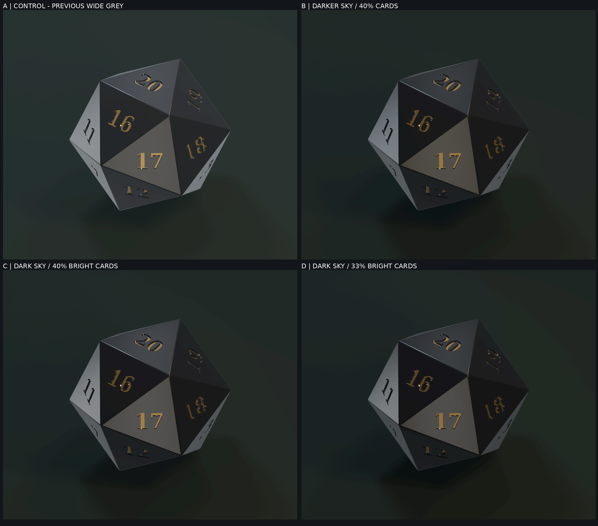

# M5 D20 black-glass studio: four actual Godot Mobile frames

**2026-10-14. Technical experiment PASS; premium-art acceptance NOT VERIFIED.**
**Scope:** isolated `experiment/m5-learn-codex-d20` branch. No change to app runtime, approved overhead camera, physical Jolt rolls, main, or draft PR #23. The generated die in this study is **not** the exact owner's Codex GLB and **not** the owner-selected Blendkit procedural material.

## Original visual evidence (clickable full-resolution image)

- [A: existing silver-gray studio, source PNG](../evidence/m5-d20-blackglass-2026-10-14/godot_brdf_ref.png)
- [B: dark ambient, 40% card width, source PNG](../evidence/m5-d20-blackglass-2026-10-14/godot_black40_lowfill.png)
- [C: dark ambient, 40% card width, 1.6× card energy, source PNG](../evidence/m5-d20-blackglass-2026-10-14/godot_black40_specular.png)
- [D: narrower 33% cards, 1.75× card energy, source PNG](../evidence/m5-d20-blackglass-2026-10-14/godot_black33_specular.png)
- [Full source metrics and SHA256](../evidence/m5-d20-blackglass-2026-10-14/blackglass-real-source-metrics.json)
- [Physical HDR luminance/card-width parameters](../evidence/m5-d20-blackglass-2026-10-14/blackglass-studio-source.json)

**Live proof:** [Godot 4.6.3 Mobile / Mesa software Vulkan CI #38593819713](https://github.com/xxiamadelxx-blip/dice-metal-barbie/actions/runs/38593819713) SUCCESS; raw frame/HDR/log artifact [#11909436065](https://github.com/xxiamadelxx-blip/dice-metal-barbie/actions/runs/38593819713/artifacts/11909436065). Real source screenshot collection added by [Actions commit `f69f355c`](https://github.com/xxiamadelxx-blip/dice-metal-barbie/commit/f69f355c90c5803c87f48e8cb31edc5f17db8fe6). PNGs are 1000×850 actual viewport frames with a 2032×1792 four-way contact sheet, not AI images or re-rendered Photoshop composites.

## Controlled A/B design

All four captures use the **same authored** GLB SHA256
`ec7bcee05f9d6b571b1db0db4ebc09d726b1aedd53a53159c067032c7c74987f`,
same stone PBR texture bytes, embedded albedo/roughness/normal, original
inlaid metallic gold meshes, satin stone edge meshes, orthographic review camera,
same Godot settings and Jolt-independent static test pose. The three new
experiments change *only* physically plausible equirectangular Sky/IBL HDR
light-card angular size, intensity and neutral environmental radiance.
No emitted/painted highlights on stone, no metallic obsidian and no BaseColor
darkening to cheat the source image. The Blender Z-up to Godot Y-up longitude
remap is honored in `tools/visual/d20_blackglass_studio.py`.

| Real original frame | ROI mean RGB (0–255) | ROI bright fraction >100 | Mean absolute RGB change from original | Fraction ROI pixels changed >8 |
| --- | ---: | ---: | ---: | ---: |
| A `brdf_ref` | 58.17 | 8.66% | control | control |
| B `black40_lowfill` | 43.42 | 4.49% | 14.75 | 97.79% |
| C `black40_specular` | 45.75 | 4.98% | 12.425 | 84.16% |
| D `black33_specular` | 40.49 | 4.13% | 17.681 | 99.86% |

ROI is x=250:780, y=155:725 including background. Brightness alone **does not** measure quality or face/gold readability. The changed-pixel gate establishes that reflections actually changed in rendered source frames; it does **not** grade premium aesthetics or guarantee physical correctness during a Jolt roll. No candidate has been promoted.

## True Gauntlet result

1. Existing black-studio source-hash validation, deterministic HDR encoding/decoding and no-background-painted-gems **PASS**.
2. Actual source GLB re-import in Godot 4.6.3 **PASS**.
3. Four real native Godot Mobile source PNGs **PASS** (nonblank pixels, source logs free of GDScript parse/crash, authentic rendering metadata).
4. Four-way original PNG SHA manifest and measurable source differences **PASS**.
5. First workflow [#38593132441](https://github.com/xxiamadelxx-blip/dice-metal-barbie/actions/runs/38593132441) **FAIL** after all renders/checks passed, because the container ran `git config user.name` without a git metadata working tree (`fatal: not in a git directory`). **Root-cause route changed**: GitHub Git Data API blobs→tree→commit→nonforce ref update, no shell Git dependency. Full exact-source rerun [#38593819713](https://github.com/xxiamadelxx-blip/dice-metal-barbie/actions/runs/38593819713) **PASS**, PNGs actually visible in repo. Raw source frame hashes in metadata verify the published byte identities.
6. Independent **vision-capable** critic / owner premium judgment **NOT VERIFIED**. Numerical pixel QA and a GitHub Actions success are not artistic signoff.

## Product decision, blockers and next action

**Do NOT equate darker with polished obsidian approval.** Candidate C preserves more bright specular pixels than B/D while being appreciably darker than A, so it is a **review candidate, not an accepted skin**. The user-selected Blendkit `Procedural Obsidian` `.blend` has not been acquired: two legitimate anonymous source requests returned 403 [documentation](M5_SELECTED_BLENDKIT_OBSIDIAN_SOURCE_GATE_2026-10-14.md). Do not substitute these new HDR images for the user's chosen material.

Next work, only after review of the actual source frames: apply a **legitimately acquired** material to original Blender D20, bake BaseColor / Roughness / tangent Normal (and genuinely measured AO if available), export one GLB and verify embedded bytes against actual Godot Mobile frames. If the exact Blendkit asset is not obtainable, keep this lighting A/B as isolated research instead of claiming exact reference fulfillment.

Further gates: actual moving Jolt rolls, correct visible D20 face ↔ displayed result, full-frame video, 6/9 readability, Android emulator gesture QA, physical OnePlus Nord 3 offline performance and owner visual approval are **NOT VERIFIED**. PR #23 and main remain unchanged.
